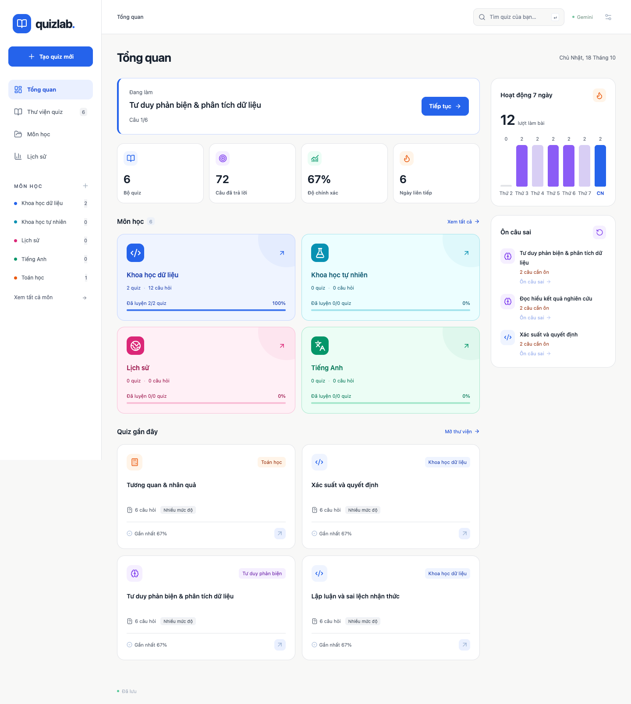
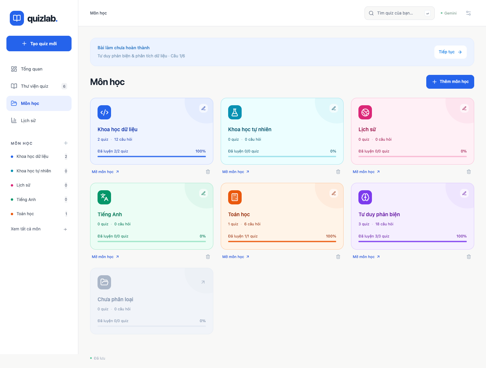
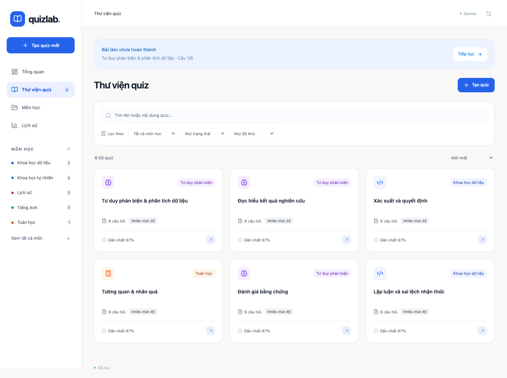
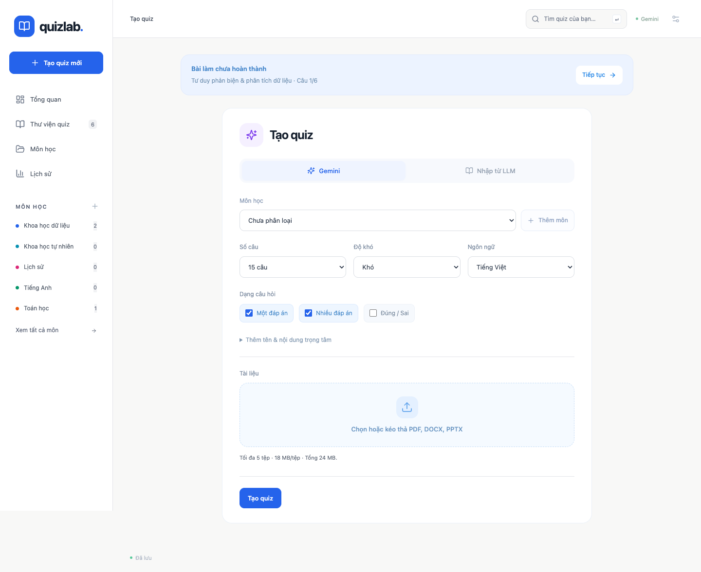
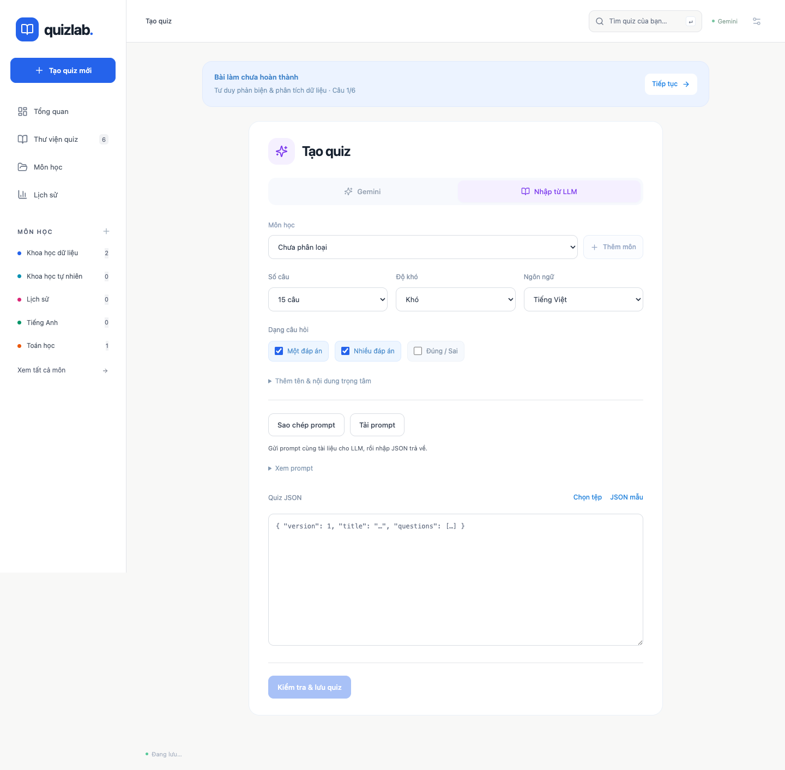
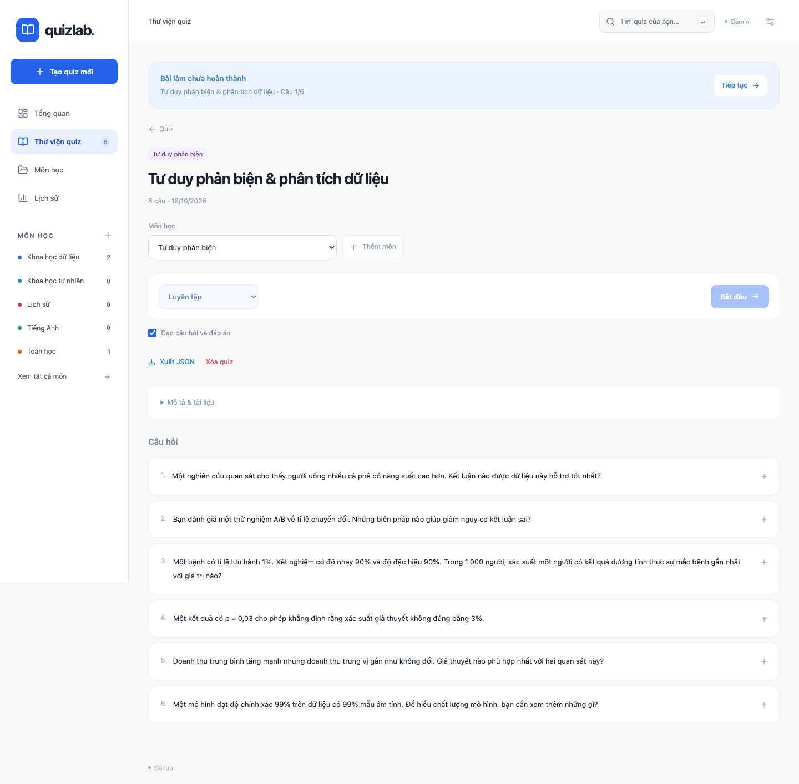
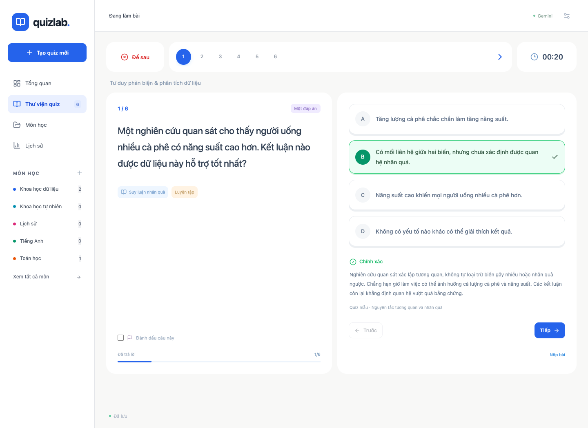
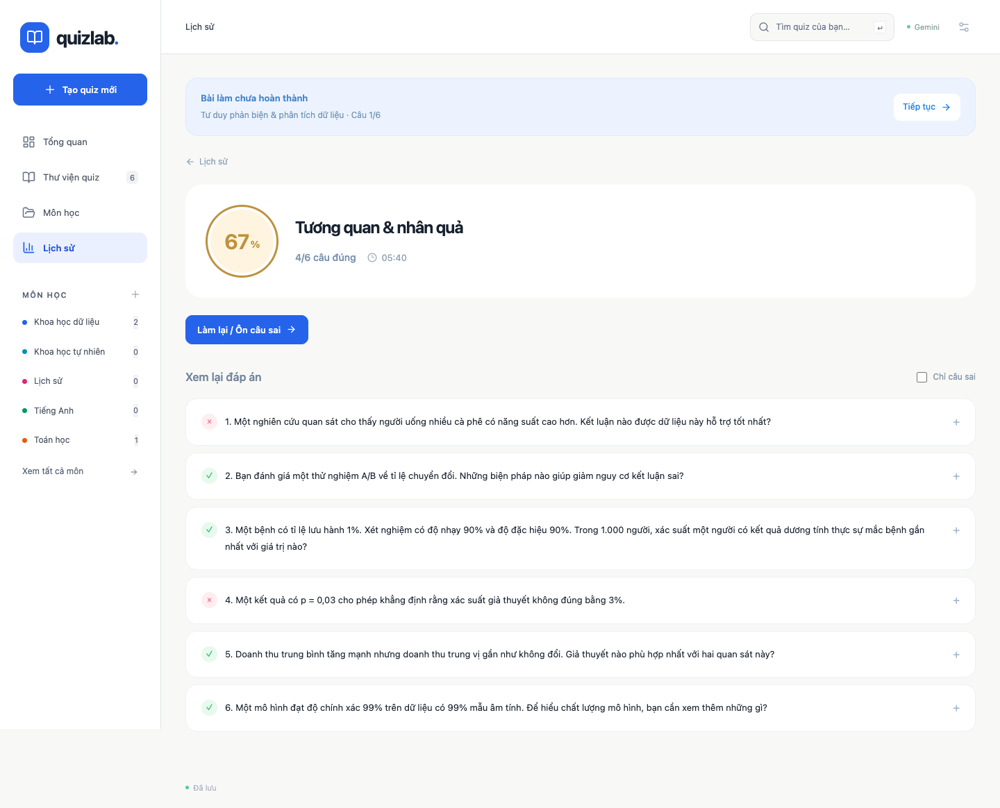
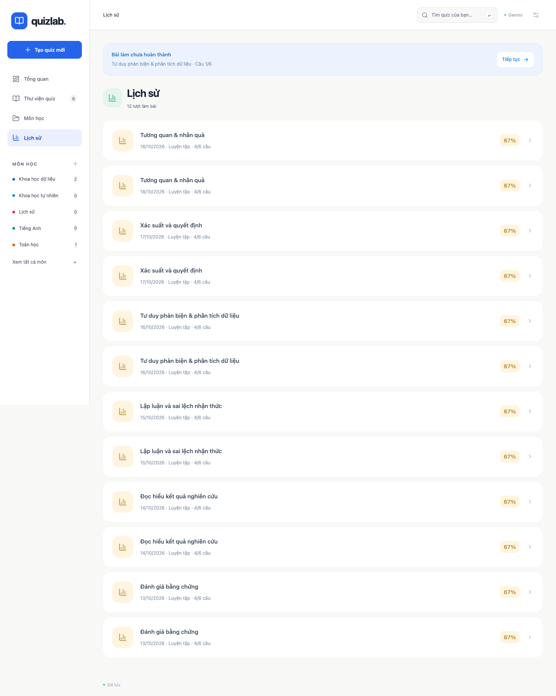
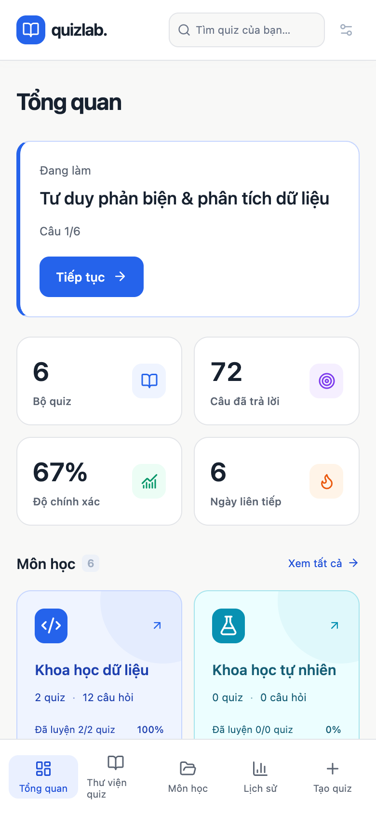

# Quizlab

**Biến tài liệu thành bộ câu hỏi để luyện tập, thi thử và ôn câu sai.**

Quizlab hỗ trợ PDF, DOCX và PPTX với hai cách tạo quiz: dùng Gemini đọc tài liệu trực tiếp hoặc mang prompt sang LLM bạn chọn rồi nhập JSON. Có dashboard, phân loại theo môn học và tự lưu tiến độ bằng SQLite.



## Tính năng

| | |
| --- | --- |
| Tạo quiz | Gemini hoặc nhập JSON từ LLM; cấu hình số câu, độ khó, dạng câu, ngôn ngữ và trọng tâm |
| Môn học | Tạo, đổi tên, chọn màu/icon và phân loại bộ quiz |
| Luyện tập | Kiểm tra từng câu, lời giải, nguồn đối chiếu, đảo câu/đáp án và đánh dấu |
| Thi thử | Giới hạn thời gian, tự nộp khi hết giờ và xem đáp án sau khi nộp |
| Ôn câu sai | Luyện lại câu sai và câu bỏ trống của lượt làm gần nhất |
| Theo dõi | Dashboard, hoạt động 7 ngày, lịch sử và kết quả từng lượt |
| Lưu trữ | Bài làm và tác vụ được lưu trên ổ đĩa; tải lại trang vẫn tiếp tục được |
| Sao lưu | Xuất snapshot SQLite chứa quiz, tệp gốc, lịch sử và tiến độ |

## Giao diện

Ảnh chụp trực tiếp từ ứng dụng với **dữ liệu minh họa**, không sử dụng tài liệu hoặc lịch sử cá nhân.

### Môn học



### Thư viện quiz



### Tạo quiz bằng Gemini



### Nhập quiz từ LLM



### Cấu hình làm bài



### Luyện tập



### Kết quả



### Lịch sử



### Mobile



## Chạy

Node.js **22.13 trở lên** (khuyên dùng Node 24+).

```sh
git clone https://github.com/gangstat197/quizlab.git
cd quizlab
npm install
cp .env.example .env
```

Chạy lệnh sao chép `.env` chỉ khi cài mới. Điền API key vào `.env` để dùng Gemini; luồng nhập JSON không cần key. Giữ nguyên `.env` hiện có khi nâng cấp.

```dotenv
GEMINI_API_KEY=your_key_here
GEMINI_MODEL=gemini-2.5-flash
PORT=3001
```

```sh
npm run dev
```

Mở **http://127.0.0.1:5173**. Đổi `.env` hoặc code backend thì khởi động lại lệnh trên. Nếu đổi `PORT`, cập nhật proxy trong `vite.config.js`.

## Lưu trữ và khôi phục

**`data/quizlab.sqlite`** chứa quiz, toàn bộ lịch sử, bài đang làm, bản nháp cấu hình/JSON, tác vụ tạo quiz và tệp gốc đã tải lên. SQLite dùng WAL và `synchronous=FULL`; thao tác quan trọng được commit trong transaction trước khi API xác nhận thành công. Thư mục `data/` đã được gitignore.

- **Ctrl+R hoặc đóng tab trong khi Gemini đang chạy:** tác vụ tiếp tục ở backend. Mở lại trang sẽ lấy trạng thái và kết quả từ database. Không cần giữ nguyên tab hoặc cổng frontend để xem quiz đã lưu.
- **Dừng/khởi động lại backend:** tác vụ chưa xong tự được đưa lại vào hàng đợi từ tệp đã lưu. Một request Gemini đang chạy trước khi backend tắt phải được gửi lại; đây là thực thi lại tác vụ, không tiếp tục request cũ ở Google. Có thể phát sinh thêm một lượt gọi API. Kết quả mỗi tác vụ dùng cùng một ID để không nhân đôi quiz.
- **Làm bài:** mỗi đáp án, câu đang xem, đánh dấu và kiểm tra đáp án đều được ghi vào SQLite. Trình duyệt có hàng đợi thao tác dự phòng, ghi ngay vào localStorage trước khi gửi API; tải lại khi chưa nhận ACK sẽ gửi lại thao tác với cùng ID, không áp dụng hai lần. Trạng thái “Đã lưu” chỉ hiển thị khi backend đã xác nhận. Mất kết nối sẽ hiện “Chưa đồng bộ” và tự thử lại.
- **Thi thử:** deadline tuyệt đối được lưu trên server, không đặt lại khi refresh. Khi mở lại bài đã quá giờ, server tự chấm theo deadline. Thao tác chưa đến server trước deadline không được tính thêm vào bài đã hết giờ.
- **Chưa nhấn tạo quiz:** cấu hình và JSON nháp được lưu, tệp đã chọn giữ bằng IndexedDB của trình duyệt. Cần đợi tải tệp lên hoàn tất trước khi đóng trang; chỉ khi backend trả về ID tác vụ thì tệp mới được lưu vào SQLite. IndexedDB/localStorage phụ thuộc origin và trình duyệt.
- **Dữ liệu phiên bản cũ:** lần mở đầu tự chuyển quiz, lịch sử và bài đang làm từ `quizlab.v1.*` vào database. Không xóa bản cũ, không ghi đè quiz mới và không nhân đôi dữ liệu. Cần mở bằng cùng trình duyệt/origin cũ để đọc localStorage đó.

Đây là ứng dụng một người dùng trên máy local: cùng backend dùng chung một thư viện và một bài làm đang hoạt động. Backend cần chạy để đọc/ghi database. Không chạy hai instance backend vào cùng một thư mục dữ liệu.

## Sao lưu

Mở biểu tượng cài đặt → **Tải bản sao lưu**. API tạo snapshot SQLite nhất quán gồm cả tệp gốc, lịch sử, bài đang làm và tác vụ. Có thể tải khi ứng dụng đang chạy.

Khôi phục: dừng backend, giữ một bản sao thư mục `data/` hiện tại, sau đó thay database bằng file sao lưu với tên `data/quizlab.sqlite`; không để lại file `quizlab.sqlite-wal` hoặc `quizlab.sqlite-shm` của database cũ trong thư mục khôi phục. Khởi động lại backend. Tác vụ chưa hoàn thành trong snapshot sẽ được thực thi lại.

Có thể đổi thư mục dữ liệu bằng biến `QUIZLAB_DATA_DIR`. Không xóa thư mục dữ liệu khi cập nhật ứng dụng.

## Sử dụng

- **Tổng quan:** tiếp tục bài làm dở, số quiz, số câu thực sự đã trả lời trong bài đã nộp, độ chính xác theo tổng số câu, chuỗi ngày học, biểu đồ hoạt động 7 ngày và gợi ý ôn câu sai. Mọi số liệu lấy từ lịch sử thật; chưa có bài làm thì độ chính xác hiện `—`.
- **Môn học:** tạo/sửa tên, chọn màu/icon, xem quiz và tiến độ từng môn. Chọn môn ngay khi tạo quiz (cả Gemini và nhập JSON), hoặc chuyển quiz cũ sang môn khác ở trang chi tiết. Quiz cũ mặc định ở **Chưa phân loại**. Xóa môn chuyển quiz/tác vụ/nháp về chưa phân loại và giữ nguyên lịch sử.
- **Thư viện:** tìm theo tên/nội dung, lọc môn, độ khó, đã/chưa luyện; sắp xếp theo tên, thời gian tạo hoặc hoạt động gần nhất. Độ khó lọc theo những mức xuất hiện trong bộ quiz.
- **Quiz:** danh sách bộ câu hỏi đã lưu; trạng thái tác vụ hiện phía trên. Có hủy, thử lại tác vụ bằng tệp gốc và xóa tác vụ đã kết thúc. Xóa tác vụ giải phóng tệp gốc của nó, không xóa quiz đã tạo.
- **Tạo mới → Gemini:** chọn cấu hình và tài liệu, nhấn Tạo quiz. Upload xong sẽ chuyển về danh sách; backend tự đọc tài liệu, tạo và lưu kết quả.
- **Tạo mới → Nhập từ LLM:** chọn cấu hình, sao chép prompt, gửi cùng tài liệu trực tiếp cho LLM. Nhập JSON trả về hoặc chọn tệp JSON, nhấn Kiểm tra & lưu. Luồng này không gọi API.
- **Làm bài:** luyện tập, thi thử có thời gian, ôn câu sai của lượt làm gần nhất. Có đảo câu/đáp án, đánh dấu câu và tiếp tục bài làm dở. Chấm câu nhiều đáp án theo tập đáp án chính xác; câu trống tính sai.
- **Lịch sử:** giữ toàn bộ các lượt nộp, điểm và lời giải. Không giới hạn 100 lượt như phiên bản trước.
- Mỗi quiz có xem trước, xuất JSON và xóa. Xóa quiz không xóa lịch sử đã làm.

## Tài liệu và giới hạn

- Tối đa **5 tệp**, **18 MB/tệp**, tổng **24 MB**.
- PDF gửi trực tiếp cho Gemini đọc văn bản, trang scan và hình ảnh.
- DOCX đọc đoạn văn, bảng, header/footer, chú thích và ảnh nhúng PNG/JPEG/WebP.
- PPTX đọc văn bản theo số slide và ảnh nhúng PNG/JPEG/WebP.
- Office không được render nguyên bố cục; biểu đồ, SmartArt, công thức đồ họa và vector có thể không được giữ đầy đủ. Xuất **PDF** nếu tài liệu phụ thuộc vào các thành phần đó. DOC/PPT cũ cũng cần chuyển định dạng.
- Office tối đa 36 MB sau giải nén, 2.000 thành phần, 40 ảnh và 500.000 ký tự/tệp. JSON nhập tối đa 4 MB.
- Tối đa 2 tác vụ chạy đồng thời, 10 tác vụ đang chạy/chờ; thời gian xử lý mỗi tác vụ tối đa 3 phút, không tính thời gian chờ hàng đợi. Thất bại được lưu cùng thông báo lỗi và có thể thử lại.

## Prompt và JSON

Prompt dùng chung ở `shared/quiz.js`: câu dẫn thường 10–25 từ, không nhắc slide/học liệu, bẫy ở khái niệm hoặc điều kiện dễ nhầm. Các lựa chọn cùng cấu trúc và cân độ dài, tránh để đáp án đúng nổi bật. Nguồn đối chiếu chỉ trong trường `source` sau khi làm bài. Các yêu cầu chất lượng ngôn ngữ này hướng dẫn LLM, chưa có bộ thẩm định học thuật tự động.

Mẫu: `examples/quiz.json`. Schema: `examples/quiz.schema.json`. `answer` là mảng chỉ số bắt đầu từ **0**. `type` nhận `single`, `multiple`, `true_false`; `difficulty` nhận `balanced`, `hard`, `expert`. Import vẫn chấp nhận quiz cũ có 2–6 lựa chọn, đồng thời kiểm tra ID trùng, chỉ số đáp án, lời giải và nguồn bắt buộc.

## Kiểm tra và bản production local

```sh
npm test
npm run build
npm start
```

Bản build và API cùng chạy ở **http://127.0.0.1:3001**. Tests dùng database tạm và Gemini giả lập, không gọi Google, không chạm dữ liệu thật. Có kiểm thử refresh, restart, SIGKILL, khôi phục tác vụ, chống ghi lặp, migration, deadline thi thử, sao lưu và chấm điểm.

API key chỉ ở `.env` backend. Chỉ chế độ Gemini gửi nội dung tài liệu đến Google. Backend bind `127.0.0.1`; ứng dụng này chưa có đăng nhập/phân quyền cho dịch vụ công khai. Giao diện dùng font hệ thống, không tải Google Fonts.

## Tham khảo thiết kế

Dashboard ưu tiên tiếp tục học và tiến độ theo cách tổ chức của [Khan Academy Learner Home](https://support.khanacademy.org/hc/en-us/articles/360030629852-What-is-my-Learner-Home-page-and-what-can-I-do-there). Môn học gom các bộ quiz theo mô hình [folder của Quizlet](https://help.quizlet.com/hc/en-us/articles/360030986151-Organizing-study-content-with-folders). Bộ lọc thư viện tham khảo [Wayground Library](https://help.wayground.com/support/solutions/articles/158000405112-navigate-my-library-and-wayground-library). Màu nhấn, hình khối bo tròn và hình minh họa nhẹ tham khảo [ngôn ngữ hình ảnh Duolingo](https://blog.duolingo.com/shape-language-duolingos-art-style/), với bảng màu và bố cục riêng cho Quizlab.

Phần trăm trên thẻ môn là **tỷ lệ quiz đã được luyện ít nhất một lần**, không phải mức thành thạo. Độ chính xác dashboard là tổng câu đúng / tổng câu trong các lượt đã nộp (câu bỏ trống tính sai). Chuỗi ngày tính theo múi giờ trình duyệt, có thể tiếp tục từ hôm qua nếu hôm nay chưa học. Lịch sử của quiz đã xóa vẫn được tính trong thống kê tổng, nhưng không còn trong gợi ý ôn lại hay thống kê môn hiện tại.

## Cấu trúc mã nguồn

```text
src/          Giao diện React, dashboard, môn học và trình làm bài
server/       Express API, xử lý tài liệu, hàng đợi Gemini và SQLite
shared/       Schema quiz, prompt, chấm điểm và thống kê dùng chung
tests/        Kiểm thử API, lưu trữ, tài liệu và logic quiz
examples/     Quiz JSON và JSON Schema mẫu
docs/         Ảnh chụp giao diện
```

Công nghệ: React 19, Vite 6, Express 5, Zod, Lucide và SQLite tích hợp trong Node.js.
